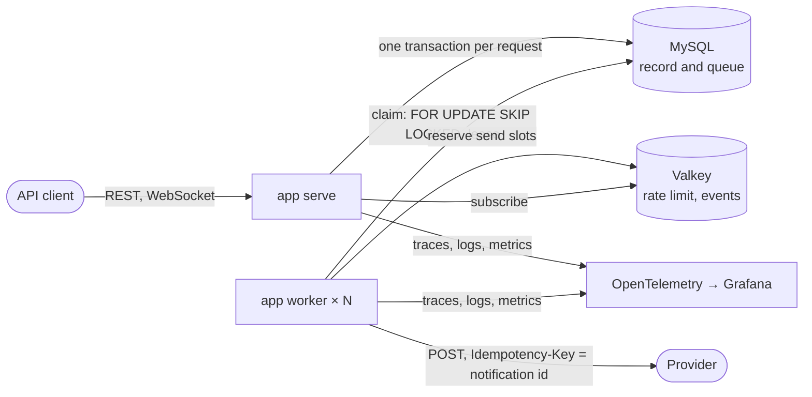

# Notification system

Accepts SMS, email and push notifications over HTTP, queues them in MySQL and delivers them to an external provider at no more than 100 messages per second per channel, with priorities, retries, a circuit breaker, scheduling, templates, status tracking and a WebSocket stream of status changes. Go, MySQL 8.4, Valkey 9, OpenTelemetry.

## Run it (needs only Docker)

```bash
docker compose up --build --wait
```

MySQL, Valkey, the API, three delivery workers, a stand-in for the provider and Grafana. Host ports and every variable compose reads are in [`docker-compose.yml`](docker-compose.yml); defaults: API on 8080 (reference at http://localhost:8080/docs), provider stand-in on 8090 (`/_control/stats`), Grafana on 3000, MySQL on 3306 (database, user and local password in the compose file). `docker compose down` stops it.

## Try it

One line each; double quotes only, so they run unchanged in bash, zsh, PowerShell 7 and Windows `cmd` (in Windows PowerShell 5.1 type `curl.exe`). Request bodies are in [`examples/`](examples); `--json` needs curl 7.82 or later.

```bash
curl -s --json "@examples/sms.json" -H "Idempotency-Key: order-1001-sms" localhost:8080/v1/notifications
```

```bash
curl -s localhost:8080/v1/notifications/<id>
```

```bash
curl -s --json "@examples/batch.json" localhost:8080/v1/notifications/batch
```

```bash
curl -s -X PUT --json "@examples/template.json" localhost:8080/v1/templates/welcome
```

```bash
curl -s --json "@examples/templated.json" localhost:8080/v1/notifications
```

```bash
curl -s -X PUT --json "@examples/fault.json" localhost:8090/_control/faults
```

```bash
curl -s "localhost:8080/v1/notifications?status=failed"
```

Every endpoint, field, limit and error is in the API reference at `/docs`. Live status: `npx wscat -c "ws://localhost:8080/v1/ws?notificationId=<id>"`.

## Where each thing is defined

| What | Source of truth |
|---|---|
| HTTP and WebSocket contract | [`api/openapi.yaml`](api/openapi.yaml), rendered at `/docs`; server types are generated from it |
| Database | [`schema/`](schema), one file per aggregate; [`migrations/`](migrations) are generated from it |
| Settings and secrets | [`config/`](config); `go run ./cmd/app env` prints every setting with its default and bounds, `app env check` validates an environment |
| Limits (lengths, batch size) | [`internal/notification/limits.go`](internal/notification/limits.go); the spec and the schema repeat them and a test asserts they agree |
| Why it is built this way | [`docs/decisions/`](docs/decisions) |
| Requirements, the test that proves each, measured numbers | [`docs/REQUIREMENTS.md`](docs/REQUIREMENTS.md) |
| Dev commands | `go tool -modfile=tools.mod task --list` |

## How it works



One binary, three roles (`app migrate`, `app serve`, `app worker`); no process assumes it is the only one.

- The queue is the notifications table: workers claim due rows with `SKIP LOCKED` under a lease, so a crashed worker's rows come back ([0003](docs/decisions/0003-mysql-is-record-and-queue.md), [0018](docs/decisions/0018-many-instances-one-database.md)).
- One state machine; every change is a conditional update, so a cancel racing a worker has one winner ([0005](docs/decisions/0005-one-state-machine-attempts-recorded.md)).
- The rate limit is shared by all workers through Valkey and paced 5% under the limit; a slot that cannot be kept is given up, never sent late ([0009](docs/decisions/0009-global-rate-limit-in-valkey.md)).
- Retries are classified and jittered, the breaker stops claiming a failing channel, the dead letter is the `failed` status ([0007](docs/decisions/0007-retries-classified-jittered-stored.md), [0008](docs/decisions/0008-breaker-pauses-claiming.md)).
- Delivery is at least once; the provider receives the notification id as `Idempotency-Key` ([0006](docs/decisions/0006-at-least-once-with-provider-key.md)).
- One correlation id and one trace cover the request, the queue wait and the provider call ([0019](docs/decisions/0019-one-correlation-id-one-trace.md)).

Operating notes: the API has no authentication of its own and belongs behind a gateway; with MySQL down it answers 503 with `Retry-After` (repeat with the same `Idempotency-Key`); with Valkey down it keeps accepting while workers stop sending. `/healthz` is liveness, `/readyz` checks MySQL and Valkey.

## Code layout

```
api/  schema/  migrations/  config/   contracts and settings
cmd/app  cmd/fakeprovider             entry points; cmd/app wires the packages
internal/notification                 vocabulary, state machine, limits, ports
internal/intake                       accept, read, cancel, retry
internal/delivery (limiter, breaker)  the worker loop and its policies
internal/httpapi                      HTTP and WebSocket handlers, generated server, /docs
internal/store                        SQL queries (sqlc) and the queue
internal/provider  internal/realtime  provider client; status events over Valkey
internal/telemetry                    logs, traces, metrics
internal/fakeprovider                 the provider stand-in
test/acceptance                       black-box tests, one per requirement
tools/                                repo tooling (schema diff, commit check, agent guards, QA scripts)
```

## Test and develop

Needs Go and Docker. `go tool -modfile=tools.mod task test:all` runs unit, integration and acceptance tests; `task check` is the local gate. The rate tests assert the cap (100 in any second) everywhere and throughput floors on a machine that keeps time; set `ACCEPTANCE_RATE_FLOOR=40` on a loaded machine. Commit hooks are optional: `lefthook install`. How AI agents built this: [`docs/AI-WORKFLOW.md`](docs/AI-WORKFLOW.md).

## Release

`main` moves by fast-forward, so it holds the commits CI tested; a release is cut by hand from a green commit: `gh workflow run release -f version=v1.0.0` ([0021](docs/decisions/0021-fast-forward-main-releases-cut-by-hand.md)).
