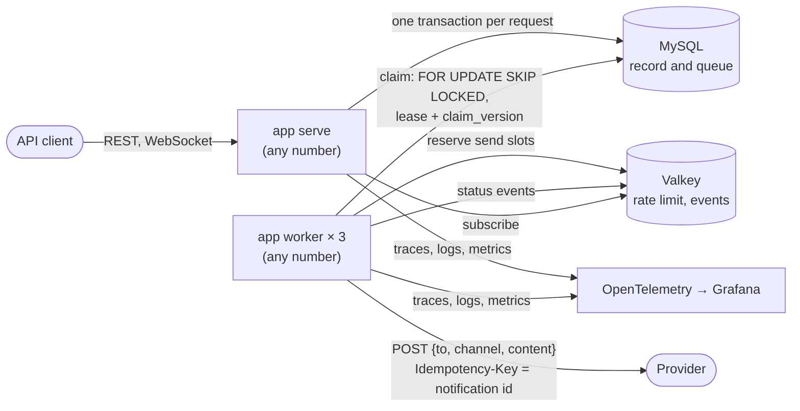

# Notification system

Accepts notification requests for SMS, email and push, queues them, and delivers them to an external provider at no more than 100 messages per second per channel, with priorities, retries, a circuit breaker, scheduling, templates, status tracking and live status events.

Go 1.27, MySQL 8.4 (the record and the queue), Valkey 9 (the shared rate limit and event fan-out), OpenTelemetry.

## Run it (needs only Docker)

```bash
docker compose up --build --wait
```

That starts MySQL, Valkey, the API, three delivery workers, a local stand-in for the provider, and Grafana. Nothing else to install or configure.

| What | Where |
|---|---|
| API reference (rendered OpenAPI; the viewer script loads from a CDN, so it needs internet) | http://localhost:8080/docs |
| OpenAPI document | http://localhost:8080/openapi.json (source: [`api/openapi.yaml`](api/openapi.yaml)) |
| Readiness | http://localhost:8080/readyz |
| Metrics | http://localhost:8080/v1/metrics |
| Provider stand-in: what it received | http://localhost:8090/_control/stats |
| Grafana: traces, logs, metrics | http://localhost:3000 |

`docker compose down` stops it; add `-v` to drop the database volume. If a port is taken, set `APP_PORT`, `PROVIDER_PORT` or `GRAFANA_PORT` before `docker compose up` (compose variables, listed under Settings).

## Try it

Send one notification and read its status:

```bash
curl -s -X POST localhost:8080/v1/notifications \
  -H 'Content-Type: application/json' \
  -H 'Idempotency-Key: order-1001-sms' \
  -H 'X-Correlation-ID: demo-1' \
  -d '{"to":"+905551234567","channel":"sms","content":"Your code is 4821","priority":"high"}'
```

```json
{"id":"<uuid>","to":"+905551234567","channel":"sms","priority":"high","status":"pending","attempts":0,"correlationId":"demo-1","…":"…"}
```

```bash
curl -s localhost:8080/v1/notifications/<id>
```

A moment later the status is `sent`, with the provider's message id and one entry in `deliveryAttempts`.

A batch of up to 1000, stored all or nothing:

```bash
curl -s -X POST localhost:8080/v1/notifications/batch \
  -H 'Content-Type: application/json' \
  -d '{"notifications":[
        {"to":"ada@example.com","channel":"email","content":"Welcome"},
        {"to":"device-token-1","channel":"push","content":"Sale starts now","priority":"low"}]}'
curl -s localhost:8080/v1/batches/<batchId>
```

A template, and a notification that uses it, scheduled for one hour from now (`scheduledAt` may be up to 30 days ahead; on macOS use `date -u -v+1H`):

```bash
curl -s -X PUT localhost:8080/v1/templates/welcome \
  -H 'Content-Type: application/json' -d '{"body":"Hello {{name}}, welcome aboard."}'
curl -s -X POST localhost:8080/v1/notifications \
  -H 'Content-Type: application/json' \
  -d '{"to":"ada@example.com","channel":"email","template":{"name":"welcome","variables":{"name":"Ada"}},"scheduledAt":"'"$(date -u -d '+1 hour' +%Y-%m-%dT%H:%M:%SZ)"'"}'
```

Its status is `scheduled`. Cancel it while it waits, list with filters, read the numbers:

```bash
curl -s -X POST localhost:8080/v1/notifications/<id>/cancel
curl -s 'localhost:8080/v1/notifications?status=cancelled&channel=email&limit=20'
curl -s 'localhost:8080/v1/metrics?windowSeconds=60'
```

A notification that used up its attempts is `failed`: the dead letter. List them and replay one (a cancelled or sent notification answers 409):

```bash
curl -s 'localhost:8080/v1/notifications?status=failed'
curl -s -X POST localhost:8080/v1/notifications/<failed id>/retry
```

Live status events over WebSocket (every change, or one notification, or one batch):

```bash
npx wscat -c 'ws://localhost:8080/v1/ws?notificationId=<id>'
```

Make the provider fail and watch retries and the breaker (the stand-in's control API):

```bash
curl -s -X PUT localhost:8090/_control/faults -H 'Content-Type: application/json' \
  -d '{"rules":[{"channel":"sms","mode":"status","status":503,"count":50}]}'
curl -s -X DELETE localhost:8090/_control/faults
```

### Endpoints

| Method and path | What it does |
|---|---|
| `POST /v1/notifications` | Queue one notification (`to`, `channel`, `content` or `template`, `priority`, `scheduledAt`) |
| `POST /v1/notifications/batch` | Queue 1 to 1000 atomically |
| `GET /v1/notifications/{id}` | Status, attempt count, last error, attempt history |
| `GET /v1/notifications` | List, newest first; filters `status`, `channel`, `batchId`, `createdFrom`, `createdTo`; `limit` and `cursor` |
| `POST /v1/notifications/{id}/cancel` | Cancel while pending (including scheduled or waiting to retry) |
| `POST /v1/notifications/{id}/retry` | Replay a failed notification (dead letter) |
| `GET /v1/batches/{id}` | Counts per status and the batch's items |
| `PUT`, `GET`, `DELETE /v1/templates/{name}`, `GET /v1/templates` | Templates with `{{variable}}` placeholders |
| `GET /v1/metrics` | Queue depth, success and failure rates, latency percentiles |
| `GET /v1/ws` | WebSocket stream of status changes |
| `GET /healthz`, `GET /readyz` | Liveness; readiness of MySQL and Valkey |

Refusals share one body: `{"code","message","details":[{"index","field","reason"}]}`. 400 names each offending field or parameter (and the item index in a batch); 409 means the notification is not in a state that allows the action; 413 is a body over 8 MiB; 422 is an `Idempotency-Key` reused with a different payload; 503 with `Retry-After` means the database cannot be reached and nothing was stored.

Limits, defined once in [`internal/core/limits.go`](internal/core/limits.go) and enforced by the spec, the service and database `CHECK`s: SMS `to` is E.164 and content is 1 to 1600 characters; email `to` is at most 254 characters and content 1 to 100,000; push `to` is a device token of 1 to 255 characters and content 1 to 1024.

## How it works



One binary, three roles: `app migrate`, `app serve`, `app worker` (plus two helpers: `app healthcheck` for the container health probe and `app env`, which prints every setting). No process assumes it is the only one.

- **Accepting.** A request is validated (spec, then service rules), templates are rendered, and the notification is stored in one transaction; a batch and its items are one transaction. The API answers `201` before anything is sent. An `Idempotency-Key` is stored in the same transaction, so the primary key decides the race between two identical requests.
- **The queue is the table.** A notification is `pending` with a due time. Workers claim due rows with `SELECT … FOR UPDATE SKIP LOCKED` under READ COMMITTED through an index that matches the query's order, so claimers never wait for each other. A scheduled notification is simply a row whose due time is in the future; a retry is the same row with a later due time. Nothing sleeps holding a message.
- **One state machine.** `pending → processing → sent | failed`, `pending → cancelled`, `processing → pending` (retry or expired lease), `failed → pending` (replay). Every change is a conditional `UPDATE … WHERE status = <from>`, so a cancel racing a worker has exactly one winner. Each provider call is one row in `delivery_attempts`.
- **Rate limit.** A GCRA limiter in Valkey, on Valkey's clock, hands out send slots spaced one interval apart across all workers. A worker reserves the next slots, claims that many rows in one query, and sends each at its slot, placed on its own clock through an offset it learns from every call to Valkey, so a slow reply cannot shift a group of sends. Slots are reserved before rows are claimed, and a job that misses its slot is released, never sent late. The limiter paces 3% under the limit so arrival jitter cannot show the provider 101 in a second. If Valkey is unreachable the workers send nothing and readiness says so. The limit is the hard rule and throughput is what gives: a slot is given up when its claim takes longer than 200 ms or its timer wakes more than one interval (10 ms) late, so a starved machine or a slow database sends fewer than 97 per second, never more than 100 (measured numbers: [`docs/REQUIREMENTS.md`](docs/REQUIREMENTS.md), row R8).
- **Priority.** Each channel's slots are split between high, normal and low by weights (70 / 20 / 10). A priority that has nothing due lends its slots to the next one, so high traffic gets everything when alone and low traffic always moves.
- **Retries.** One classifier decides: network errors, timeouts, 408, 425, 429 and 5xx are retried with full-jitter exponential backoff, never sooner than `Retry-After`; any other 4xx fails at once. After five calls a notification is `failed` (`exhausted`): the dead letter, listed with `status=failed` and replayable.
- **Circuit breaker.** Per channel, in each worker. While it is open the worker does not claim that channel's rows, so an outage burns no attempts and other channels keep their rate.
- **Crashes.** A claim is a lease with a version. A worker that dies leaves rows that a reaper returns to `pending`; a worker that was paused past its lease does not send (each call is capped by the lease's remaining time) and its late write changes nothing (`WHERE claim_version = ?`).
- **Events.** Every committed status change is published once through Valkey; `GET /v1/ws` streams them from any API instance. REST stays the source of truth.
- **Observability.** JSON logs carry the notification's correlation id in the API and the workers, and it is sent to the provider. The delivery span continues the accepting request's trace, so one trace covers the request, the queue wait and the provider call. `GET /v1/metrics` is computed from MySQL, so every instance gives the same numbers; the workers also export delivery attempts, provider call duration and slots given up (`notifier.*`) through OpenTelemetry, visible in Grafana.

### What "sent once" means here

Delivery is at-least-once. Duplicates are prevented on our side: client retries by `Idempotency-Key`, concurrent workers by the row lock and the lease version. A send whose outcome is unknown (a timeout after the provider accepted) is retried with the same `Idempotency-Key`, so it is delivered once only if the provider honours that key. The provider stand-in implements key dedupe as a switch (`PUT /_control/dedupe`), and the tests measure both cases.

### Operating notes

- `GET /v1/metrics` is computed from MySQL on every call and is not cached, so it always agrees with what a client just did; put it behind the same authentication and rate limiting as the rest of the API before exposing it.
- The API has no authentication of its own; it is meant to sit behind a gateway.
- If MySQL is down the API answers 503 with `Retry-After` and readiness is 503; workers keep running and resume by themselves. A send whose result could not be written is sent again when its lease ends: in a kill of MySQL mid-drain, about 100 of 9,000 were requested twice (same `Idempotency-Key`).
- If Valkey is down the API keeps accepting and answering, workers stop sending (they cannot see the shared rate limit), `/readyz` is 503, and WebSocket streams are closed rather than left with holes. Delivery resumes by itself when Valkey is back.

### What comes next at larger scale

One MySQL node carries this design to the low thousands of messages per second. Beyond that: shard by recipient hash, partition the tables by day and drop old partitions, and share breaker state between workers. The queue sits behind `core.Queue`, so a broker can replace the table without touching the workers' logic.

## Settings

Every application setting is an `APP_*` environment variable declared once in [`internal/config`](internal/config/config.go) with a default, bounds and a doc line. `go run ./cmd/app env` prints all of them as an env file, bounds included; a test fails if this table misses one.

| Variable | Default | Meaning |
|---|---|---|
| `APP_DATABASE_DSN` | required | MySQL DSN |
| `APP_DB_MAX_OPEN_CONNS` | `10` | MySQL pool size per process |
| `APP_VALKEY_ADDR` | `localhost:6379` | Valkey address |
| `APP_HTTP_ADDR` | `:8080` | Listen address of `app serve` |
| `APP_READ_HEADER_TIMEOUT` | `5s` | Time a client has to send its request headers |
| `APP_SHUTDOWN_TIMEOUT` | `10s` | Grace on SIGTERM for in-flight requests (serve) and sends (worker) |
| `APP_PROVIDER_URL_SMS`, `APP_PROVIDER_URL_EMAIL`, `APP_PROVIDER_URL_PUSH` | `http://localhost:8090/send` | Provider URL per channel |
| `APP_PROVIDER_TIMEOUT` | `5s` | One provider call |
| `APP_MAX_ATTEMPTS` | `5` | Provider calls before a notification is `exhausted` |
| `APP_RETRY_BASE`, `APP_RETRY_CAP` | `1s`, `5m` | Backoff base and cap |
| `APP_RATE_LIMIT_PER_SECOND` | `100` | The provider's limit per channel |
| `APP_RATE_LIMIT_HEADROOM_PERCENT` | `3` | How far under the limit the limiter paces |
| `APP_RATE_LIMIT_HORIZON` | `200ms` | How far ahead send slots are reserved |
| `APP_PRIORITY_WEIGHTS` | `70,20,10` | Shares of high, normal, low |
| `APP_LEASE_DURATION`, `APP_REAP_INTERVAL` | `30s`, `5s` | Claim lease; how often expired leases are returned |
| `APP_WORKER_CONCURRENCY` | `32` | Provider calls in flight per worker |
| `APP_BREAKER_WINDOW`, `APP_BREAKER_MIN_REQUESTS`, `APP_BREAKER_FAILURE_RATIO`, `APP_BREAKER_COOLDOWN` | `10s`, `10`, `0.5`, `5s` | Circuit breaker: opens when at least that many calls in the window failed at that ratio; one probe after the cool-down |
| `APP_IDEMPOTENCY_RETENTION`, `APP_IDEMPOTENCY_SWEEP_INTERVAL` | `24h`, `1m` | How long a key is remembered; how often expired keys are deleted |
| `APP_WS_SEND_BUFFER` | `256` | Events buffered per WebSocket subscriber before it is dropped |
| `APP_OTLP_ENDPOINT` | empty | OTLP/HTTP endpoint; empty disables export |
| `APP_SERVICE_NAME` | `notifier` | `service.name` on every span, metric and log |
| `APP_LOG_LEVEL` | `info` | `debug`, `info`, `warn` or `error` |

`docker compose` sets the application's settings itself and reads only these from your shell or from a `.env` file beside `docker-compose.yml`:

| Compose variable | Default | Meaning |
|---|---|---|
| `APP_PORT`, `PROVIDER_PORT`, `GRAFANA_PORT` | `8080`, `8090`, `3000` | Host ports of the API, the provider stand-in and Grafana |
| `MYSQL_PASSWORD`, `MYSQL_ROOT_PASSWORD` | `local-dev`, `local-dev-root` | Local database passwords |
| `PROVIDER_URL_SMS`, `PROVIDER_URL_EMAIL`, `PROVIDER_URL_PUSH` | the stand-in | Where each channel's messages are sent |
| `PROVIDER_DEDUPE` | `true` | Whether the stand-in honours `Idempotency-Key` |

To send to a real endpoint instead of the stand-in, export `PROVIDER_URL_SMS`, `PROVIDER_URL_EMAIL` or `PROVIDER_URL_PUSH` before `docker compose up`. A free webhook.site URL accepts about 100 requests in total, which this system sends in one second, so the stand-in is the default.

## Test

```bash
go tool -modfile=tools.mod task test:all
```

Unit tests, then the integration tests: the packages' own tests against real MySQL and Valkey (queries served by their indexes, the limiter, the worker loop) and the acceptance tests in [`test/acceptance`](test/acceptance). Those build the binary, run `serve` and several `worker` processes against real MySQL and Valkey (containers) and the provider stand-in, and assert on what an API client and the provider observe. Each test names the requirement it proves; the map is [`docs/REQUIREMENTS.md`](docs/REQUIREMENTS.md). Needs Go and Docker.

`go tool -modfile=tools.mod task check` is the full local gate (build, vet, lint, unit tests, vulnerabilities). CI runs a superset on every pull request and on `main`: race tests, the integration tests, the migration drift check, the image scan and a compose bring-up.

The rate tests assert the cap (at most 100 in any second) everywhere, and the throughput floors (90 per second over a drain, 93 in steady state) on a machine that can keep time. CI's two-core runner cannot, so the workflow sets `ACCEPTANCE_RATE_FLOOR=40` there; the floors run in full with the command above.

## Where things are

| Path | What |
|---|---|
| `api/openapi.yaml` | HTTP contract; the server interface is generated from it and requests are validated against it at runtime |
| `schema/*.sql` | Desired database state; `migrations/` is generated from it by Atlas (versioned, goose format) |
| `internal/core` | Vocabulary, the state machine, the limits, and the ports between the parts |
| `internal/intake`, `internal/api` | Accepting, validating, reading, cancelling; HTTP handlers, WebSocket |
| `internal/worker`, `internal/limiter`, `internal/breaker`, `internal/provider` | Delivery loop, rate limit, circuit breaker, provider client and retry classifier |
| `internal/store`, `migrations/` | SQL queries (sqlc), the queue; the versioned migrations, embedded in the binary |
| `internal/realtime` | Status events over Valkey |
| `internal/obs`, `internal/config` | Logs, traces, metrics; every setting |
| `internal/fakeprovider`, `cmd/fakeprovider` | The provider stand-in: faults, dedupe switch, exact counts |
| `docs/decisions` | Why things are the way they are, one record per decision |
| `docs/AI-WORKFLOW.md`, `.agents/` | How AI agents built this: roles, briefs, reviews, mistakes and how each was caught |

## Develop

Only Go and Docker are needed. Go tools are pinned in `tools.mod`; Atlas and Trivy run from Docker images pinned by digest. The commit hook is optional: install [lefthook](https://github.com/evilmartians/lefthook) and run `lefthook install`.

```bash
go tool -modfile=tools.mod task --list
```
