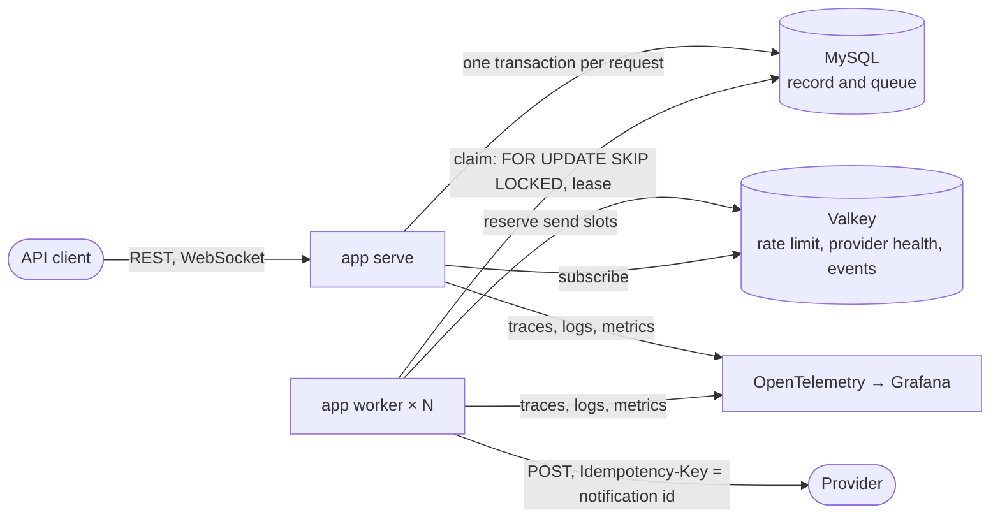

# Notification system

Accepts SMS, email and push notifications over HTTP, queues them in MySQL and delivers them to an external provider at no more than 100 messages per second per channel, with priorities, retries, a circuit breaker, scheduling, templates, status tracking and a WebSocket stream of status changes. Go, MySQL 8.4, Valkey 9, OpenTelemetry.

## Run it (needs only Docker)

```bash
docker compose up --build --wait
```

MySQL, Valkey, the API, three delivery workers, a stand-in for the provider and Grafana. Host ports and every variable compose reads are in [`docker-compose.yml`](docker-compose.yml); defaults: API on 8080 (reference at http://localhost:8080/docs), provider stand-in on 8090 (`/_control/stats`), Grafana on 3000, MySQL on 3306 (database, user and local password in the compose file). `docker compose down` stops it.

## Try it

One line each; double quotes only, so they run unchanged in bash, zsh, PowerShell 7 and Windows `cmd` (in Windows PowerShell 5.1 type `curl.exe`). Request bodies are in [`examples/`](examples); `--json` needs curl 7.82 or later.

```bash
curl -s --json "@examples/sms.json" -H "Idempotency-Key: order-1001-sms" localhost:8080/v1/notifications
```

```bash
curl -s localhost:8080/v1/notifications/<id>
```

```bash
curl -s --json "@examples/batch.json" localhost:8080/v1/notifications/batch
```

```bash
curl -s -X PUT --json "@examples/template.json" localhost:8080/v1/templates/welcome
```

Running it again answers `428`: replacing a template needs `If-Match` set to the `ETag` it returned (`"1"`), so two editors cannot overwrite each other (see `/docs`).

```bash
curl -s --json "@examples/templated.json" localhost:8080/v1/notifications
```

```bash
curl -s -X PUT --json "@examples/fault.json" localhost:8090/_control/faults
```

The provider stand-in now refuses the next SMS with a 400, a permanent failure. Send one without an `Idempotency-Key`, so it is a new notification, then list the failed ones; it is there with `failureKind` `permanent` after one attempt:

```bash
curl -s --json "@examples/sms.json" localhost:8080/v1/notifications
```

```bash
curl -s "localhost:8080/v1/notifications?status=failed"
```

A run of 503s is different: it is an outage, the channel pauses, and nothing fails or spends retry budget until the provider is back (decision 0026).

`PATCH /v1/notifications/<id>` with a new `scheduledAt` reschedules a notification no worker has tried yet. Every endpoint, field, limit and error is in the API reference at `/docs`.

Live status (needs Node): `npx wscat -c "ws://localhost:8080/v1/ws?notificationId=<id>"`; its messages are described at http://localhost:8080/docs/websocket.

## Where to look

For a review, start with the requirements ledger: each requirement of the brief, the test that proves it, and the numbers measured.

| What | Where |
|---|---|
| HTTP contract | The Huma operations in [`internal/httpapi`](internal/httpapi/api.go); [`api/openapi.yaml`](api/openapi.yaml) is generated from them (decision 0024), rendered at `/docs`, and a typed Go client in [`test/apiclient`](test/apiclient) is generated from it |
| WebSocket contract | [`api/asyncapi.yaml`](api/asyncapi.yaml), generated by `task gen` from the server's Go types (decision 0027) with the same payload schemas as the OpenAPI document, served at `/asyncapi.yaml` and rendered at `/docs/websocket` |
| Database | [`schema/`](schema), one file per aggregate; [`migrations/`](migrations) are generated from it |
| Settings and secrets | [`config/`](config); `go run ./cmd/app env` prints every setting with its default and bounds, `app env check` validates an environment |
| Limits (lengths, batch size) | [`internal/notification/limits.go`](internal/notification/limits.go); the API reads them, so the generated spec carries them; the schema repeats them and a test asserts they agree |
| Why it is built this way | [`docs/decisions/`](docs/decisions) |
| Requirements, the test that proves each, measured numbers | [`docs/REQUIREMENTS.md`](docs/REQUIREMENTS.md) |
| How AI agents built it, and where they were wrong | [`docs/AI-WORKFLOW.md`](docs/AI-WORKFLOW.md) |

## How it works



One binary, three roles (`app migrate`, `app serve`, `app worker`); no process assumes it is the only one.

- The queue is the notifications table: workers claim due rows with `SKIP LOCKED` under a lease, so a crashed worker's rows come back ([0003](docs/decisions/0003-mysql-is-record-and-queue.md), [0018](docs/decisions/0018-many-instances-one-database.md)).
- One state machine; every change is a conditional update, so a cancel racing a worker has one winner ([0005](docs/decisions/0005-one-state-machine-attempts-recorded.md)).
- The rate limit is shared by all workers through Valkey and paced 5% under the limit; a slot that cannot be kept is given up, never sent late ([0009](docs/decisions/0009-global-rate-limit-in-valkey.md)).
- Retries are classified and jittered, the breaker stops claiming a failing channel, the dead letter is the `failed` status ([0007](docs/decisions/0007-retries-classified-jittered-stored.md), [0026](docs/decisions/0026-provider-health-shared-outages-spend-no-budget.md): provider health shared in Valkey, an outage spends no attempt budget).
- Delivery is at least once; the provider receives the notification id as `Idempotency-Key` ([0006](docs/decisions/0006-at-least-once-with-provider-key.md)).
- Finished notifications and their attempts are deleted after `APP_NOTIFICATION_RETENTION` (default 7 days) by the API processes; nothing in flight is touched ([0025](docs/decisions/0025-finished-notifications-expire.md)).
- One correlation id and one trace cover the request, the queue wait and the provider call ([0019](docs/decisions/0019-one-correlation-id-one-trace.md)).

Operating notes: the API has no authentication of its own and belongs behind a gateway; with MySQL down it answers 503 with `Retry-After` (repeat with the same `Idempotency-Key`); with Valkey down it keeps accepting, reading and cancelling while workers stop sending and `/v1/ws` answers 503. `/healthz` is liveness, `/readyz` checks MySQL only ([0013](docs/decisions/0013-websocket-with-valkey-fanout.md)).

## Test and develop

Needs Docker and Go 1.21 or later (Go fetches the 1.27.4 toolchain `go.mod` asks for). Every dev command runs through Go's tool directive, so nothing else needs installing: `go tool "-modfile=tools.mod" task --list` lists them, and `task` below is short for `go tool "-modfile=tools.mod" task` (the quotes keep PowerShell from splitting the flag).

- `task test:all` runs unit, integration and acceptance tests; `task check` is the full local gate (build, vet, lint, tests, vulnerability scan).
- The rate tests assert the cap (at most 100 sends per channel in any second) on every machine, and a throughput floor that assumes an unloaded machine; set `ACCEPTANCE_RATE_FLOOR=40` on a busy one.
- Commit hooks are optional: `lefthook install`.
- `main` moves by fast-forward only, so it holds the commits CI tested; a release is cut by hand from a green commit with `gh workflow run release -f version=v1.0.0` ([0021](docs/decisions/0021-fast-forward-main-releases-cut-by-hand.md)).
